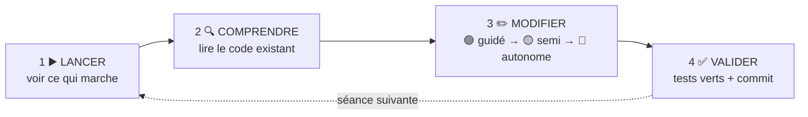

# 🗺️ Parcours BiblioTech — 8 séances de 2 heures

> Suivez les séances **dans l'ordre**, cochez [PROGRESSION.md](PROGRESSION.md) au fur et à mesure,
> et committez souvent.

---

## 🧭 La méthode : quatre temps, à chaque séance

Vous ne partez jamais d'une page blanche : l'application tourne, vous la comprenez, puis vous la faites évoluer.

| Palier | Ce qu'on vous donne | Tests |
|---|---|---|
| 🟢 **Guidé** | L'objectif, la démarche pas à pas, le code clé | groupe `seance-NN` |
| 🟡 **Semi-guidé** | L'objectif, les grandes étapes, un indice | groupe `seance-NN` |
| 🔴 **Autonome** | L'objectif et le critère de réussite | groupe `bonus` (facultatif) |

Les solutions complètes ne sont pas dans le dépôt : chercher fait partie du métier.
Bloqué plus de 10 minutes ? Relisez l'indice, puis [DEPANNAGE.md](DEPANNAGE.md), puis ouvrez une
*issue* (modèle « Question » fourni) ou levez la main.

## ⏱️ Le déroulé d'une séance

| Durée | Temps | Ce que vous faites |
|---|---|---|
| 10 min | **Contrôle d'entrée** | 5 questions au portail sur les concepts de la séance précédente |
| 10 min | **Situation** | La demande de la médiathèque, lue ensemble ; on lance l'application |
| 80 min | **Missions** | 🟢 puis 🟡 ; 🔴 si vous avez fini |
| 10 min | **Valider** | `php artisan test --group=seance-NN`, commit, push |
| 10 min | **Débriefing** | Les concepts de la séance, puis votre **journal de fin de séance** |

Le journal tient en trois lignes, dans le portail : *ce que j'ai fait · ce qui m'a bloqué ·
ce que j'ai compris aujourd'hui*. Il compte dans l'évaluation de votre engagement.

## 🗺️ Les 8 séances

| # | Séance | La demande de la médiathèque | Concepts | Guide |
|---|---|---|---|---|
| 1 | **Routes, contrôleurs, vues** | « Une page contact et un classement par catégories » | MVC, routage, Blade | [▶️](seances/seance-01.md) |
| 2 | **Base de données & Eloquent** | « Nos auteurs sont saisis n'importe comment » | migrations, relations 1-N, reprise de données | [▶️](seances/seance-02.md) |
| 3 | **Gestion : lister et ajouter** | « Nous voulons saisir nous-mêmes les nouveautés » | contrôleur *resource*, formulaires, validation | [▶️](seances/seance-03.md) |
| 4 | **Gestion : modifier, supprimer** | « Et corriger nos erreurs de saisie » | PUT/DELETE, CSRF, règle de gestion | [▶️](seances/seance-04.md) |
| 5 | **Authentification & rôles** | « N'importe qui peut supprimer un livre ! » | sessions, hachage, middleware, force brute | [▶️](seances/seance-05.md) |
| 6 | **Emprunts** | « Nos adhérents veulent réserver en ligne » | association porteuse, règles métier, transactions | [▶️](seances/seance-06.md) |
| 7 | **API REST** | « L'appli mobile de la communauté de communes veut notre catalogue » | JSON, ressources, codes HTTP, jetons | [▶️](seances/seance-07.md) |
| 8 | **Qualité, sécurité, mise en ligne** | « Avant d'ouvrir au public, on veut être rassurés » | XSS, tests, CI, déploiement, E5 | [▶️](seances/seance-08.md) |

Deux **interrogations écrites** de 30 minutes, sur papier, ouvrent les séances 5 et 8.
Elles portent sur ce que vous avez codé : écrire une route, lire une requête Eloquent,
prévoir ce qu'affiche une page, repérer et corriger une faille. Pas de QCM.

## 📦 Ce qui prouve votre travail

| Preuve | Où |
|---|---|
| Les tests de chaque séance au vert | onglet **Actions** de votre dépôt (une ligne par séance) |
| Des commits réguliers et lisibles | `feat: page contact`, `fix: isbn unique en modification`… |
| `PROGRESSION.md` à jour | à la racine, committé |
| Le journal de fin de séance | portail |
| La fiche de réalisation E5 | [e5/FICHE-REALISATION.md](e5/FICHE-REALISATION.md), complétée en séance 8 |

## 🎓 Les fiches de cours

Une fiche courte par séance, avec son auto-évaluation : **[cours/](cours/README.md)**.
La bonne méthode : *lire la fiche → faire l'auto-évaluation → pratiquer dans la séance*.
Les documents longs de l'an dernier (glossaires, mémos) sont dans [cours/reference/](cours/reference/).

## 🏆 Ce que vous saurez faire à la fin

- Reprendre une application existante, la lire et la faire évoluer sans la casser
- Faire évoluer une base de données en service (migrations, reprise de données)
- Construire un back-office sécurisé : formulaires validés, rôles, protection CSRF
- Traduire des règles de gestion en code et les prouver par des tests
- Exposer une API REST et la protéger
- Mettre une application en ligne et la présenter dans votre dossier E5
