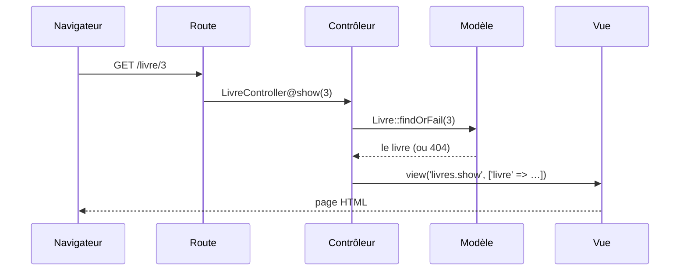

# MVC et routage

> **Séance 1** · Lecture 8 min · ▶️ [Faire la séance](../seances/seance-01.md)

## L'idée

Une application web reçoit une **requête** (une URL + un verbe) et renvoie une **réponse** (une page).
Laravel découpe ce travail en trois rôles — c'est le motif **MVC** :

| Rôle | Fichiers | Il… | Il ne… |
|---|---|---|---|
| **Modèle** | `app/Models/` | lit et écrit les données (une classe ↔ une table) | produit pas de HTML |
| **Vue** | `resources/views/*.blade.php` | met en forme les données reçues | interroge pas la base |
| **Contrôleur** | `app/Http/Controllers/` | reçoit la requête, appelle les modèles, choisit la vue | contient pas de HTML |

Devant les trois : la **route**, qui associe une URL à une action.



## Le code à reconnaître

```php
// routes/web.php
Route::get('/livre/{id}', [LivreController::class, 'show'])->name('livres.show');
Route::view('/contact', 'contact')->name('contact');            // page sans données
```
```php
// Contrôleur
public function show(int $id): View
{
    $livre = Livre::findOrFail($id);
    return view('livres.show', ['livre' => $livre]);
}
```
```blade
{{-- Vue : hérite du gabarit, remplit la section « content » --}}
@extends('layouts.app')
@section('content')
    <h1>{{ $livre->titre }}</h1>
    <a href="{{ route('livres.index') }}">Retour</a>
@endsection
```

## Les pièges

- **Écrire l'URL en dur** (`href="/livres"`) : le jour où elle change, tous les liens cassent. Utilisez `route('nom')`.
- **Interroger la base dans une vue** : ça marche, et c'est une faute d'architecture.
- **Oublier le 404** : `find()` renvoie `null` (erreur plus loin), `findOrFail()` renvoie une page 404 propre.
- **Ordre des routes** : `/livres/{id}` déclarée avant `/livres/recherche` « attrape » le mot *recherche*.

## ✅ Auto-évaluation

1. Dans quel fichier déclare-t-on qu'une URL existe ?
2. Une vue peut-elle contenir `Livre::all()` ? Pourquoi est-ce une mauvaise idée ?
3. Que renvoie `route('livres.show', 7)` ?
4. Quelle différence entre `Route::view()` et `Route::get()` vers un contrôleur ?
5. À quoi servent `@extends` et `@section` ?

<details><summary>Réponses</summary>

1. `routes/web.php` (et `routes/api.php` pour l'API).
2. Techniquement oui ; mais la vue ne doit que présenter : la requête appartient au contrôleur (et au modèle).
3. L'URL complète de la fiche du livre 7, par exemple `https://…/livre/7`.
4. `Route::view` renvoie directement une vue, sans logique ; un contrôleur prépare des données avant.
5. À hériter d'un gabarit commun (`layouts/app`) et à remplir ses zones : une seule mise en page pour tout le site.
</details>
