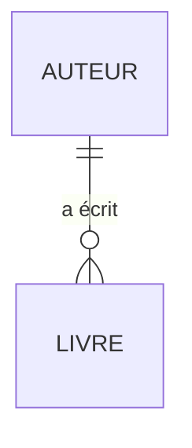

# Migrations et relations Eloquent

> **Séance 2** · Lecture 10 min · ▶️ [Faire la séance](../seances/seance-02.md)

## L'idée

- Une **migration** est un fichier PHP **versionné** qui décrit une évolution du schéma :
  créer une table, ajouter une colonne… Toute l'équipe (et le serveur de production) rejoue les
  mêmes migrations dans le même ordre : la base est reproductible.
- **Eloquent** est l'ORM de Laravel : une classe (`Livre`) ↔ une table (`livres`), un objet ↔ une ligne.
- Une **relation** se déclare des deux côtés ; la **clé étrangère** est du côté « plusieurs ».


| Côté | Méthode | Retour | Exemple |
|---|---|---|---|
| Livre (porte `auteur_id`) | `belongsTo(Auteur::class)` | un objet | `$livre->auteur->nom` |
| Auteur | `hasMany(Livre::class)` | une collection | `$auteur->livres->count()` |

## Le code à reconnaître

```bash
php artisan make:model Auteur -mf     # modèle + migration + fabrique
php artisan migrate                   # applique les migrations en attente
php artisan migrate:rollback          # annule le dernier lot (down)
php artisan migrate:fresh --seed      # ⚠️ tout supprimer, tout recréer, remplir
```
```php
Schema::table('livres', function (Blueprint $table) {
    $table->foreignId('auteur_id')->nullable()->constrained('auteurs')->nullOnDelete();
});
```
```php
Livre::with('auteur')->where('disponible', true)->orderBy('titre')->get();
Livre::whereHas('auteur', fn ($q) => $q->where('nom', 'Hugo'))->get();
Categorie::withCount('livres')->get();       // attribut livres_count
```

## Les pièges

- **Modifier une migration déjà passée** : personne d'autre ne la rejouera. On en écrit une **nouvelle**.
- **Le problème N + 1** : afficher 20 livres et leur auteur = 21 requêtes. `with('auteur')` = 2 requêtes.
- **`after('colonne')`** sur une colonne inexistante : SQLite l'ignore, **MySQL refuse**.
- **Supprimer une colonne indexée** : retirer l'index d'abord.
- **Utiliser les modèles dans une migration de données** : le modèle évoluera, la migration non. Préférez `DB::table()`.

## ✅ Auto-évaluation

1. Pourquoi ne modifie-t-on pas une migration déjà appliquée sur le serveur ?
2. Dans une relation 1 → N, de quel côté se trouve la clé étrangère ?
3. Que fait `->constrained()->nullOnDelete()` ?
4. Combien de requêtes SQL pour `Livre::with('auteur')->get()` ? Et sans `with` en affichant 20 auteurs ?
5. Quelles sont les trois étapes pour remplacer une colonne texte par une clé étrangère sur une base en service ?

<details><summary>Réponses</summary>

1. Les autres bases (collègues, production) l'ont déjà exécutée : elles ne la rejoueront pas. On ajoute une nouvelle migration.
2. Du côté « plusieurs » : `livres.auteur_id`.
3. Crée la contrainte de clé étrangère vers la table déduite ; si l'auteur est supprimé, `auteur_id` passe à NULL.
4. Deux requêtes ; sans `with`, 1 + 20 = 21 requêtes.
5. Ajouter la nouvelle colonne (nullable), transférer les données, supprimer l'ancienne colonne.
</details>
