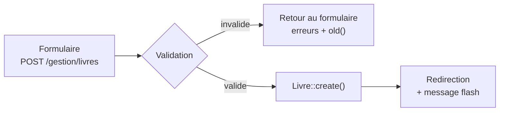

# Contrôleurs resource et validation

> **Séance 3** · Lecture 8 min · ▶️ [Faire la séance](../seances/seance-03.md)

## L'idée

Gérer une table, c'est toujours les mêmes sept actions. Laravel les nomme et les relie aux bonnes
URL : c'est le **contrôleur resource**. Et toute donnée qui arrive d'un formulaire est **suspecte**
tant qu'elle n'a pas été **validée côté serveur**.


Après un POST réussi, on **redirige** (on ne renvoie pas une page) : un rafraîchissement ne
renverra pas le formulaire une seconde fois (*Post/Redirect/Get*).

## Le code à reconnaître

```php
Route::prefix('gestion')->name('gestion.')->group(function () {
    Route::resource('livres', Gestion\LivreController::class);   // 7 routes gestion.livres.*
});
```
```php
public function store(LivreRequest $request)          // la validation a lieu AVANT d'entrer ici
{
    $livre = Livre::create($request->validated());     // seulement les champs validés
    return redirect()->route('gestion.livres.index')->with('success', 'Livre ajouté.');
}

public function show(Livre $livre) { … }               // liaison de modèle : 404 automatique
```
```php
// app/Http/Requests/LivreRequest.php
public function rules(): array
{
    return [
        'titre' => ['required', 'string', 'max:255'],
        'auteur_id' => ['required', 'exists:auteurs,id'],
        'isbn' => ['nullable', 'unique:livres,isbn'],
    ];
}
```
```blade
<input name="titre" value="{{ old('titre') }}" class="form-control @error('titre') is-invalid @enderror">
@error('titre') <div class="invalid-feedback">{{ $message }}</div> @enderror
{{ $livres->links() }}   {{-- pagination --}}
```

## Les pièges

- **Valider seulement en HTML** (`required` dans l'input) : un `curl` le contourne. La validation serveur est la seule qui protège.
- **`Livre::create($request->all())`** : enregistre tout ce que le client envoie, y compris ce qu'il n'aurait pas dû. Utilisez `validated()`.
- **`exists:auteurs,id`** oublié : un `<select>` modifié dans le navigateur envoie un id inexistant.
- **Collision de noms** : `Route::resource('livres')` sans préfixe de nom écraserait `livres.index` du site public.

## ✅ Auto-évaluation

1. Citez les 7 actions d'un contrôleur resource et leur verbe HTTP.
2. Pourquoi rediriger après un `store()` réussi ?
3. Que fait `old('titre')` ? Quand renvoie-t-il une valeur ?
4. Pourquoi déplacer les règles dans une Form Request ?
5. `show(Livre $livre)` et l'URL `/gestion/livres/999` (inexistant) : que se passe-t-il ?

<details><summary>Réponses</summary>

1. index (GET), create (GET), store (POST), show (GET), edit (GET), update (PUT/PATCH), destroy (DELETE).
2. Pour qu'un rafraîchissement ne renvoie pas le formulaire (double ajout) : motif Post/Redirect/Get.
3. Il renvoie la valeur saisie lors de la requête précédente, quand la validation a échoué et a redirigé vers le formulaire.
4. Pour réutiliser les mêmes règles (ajout, modification, API) et alléger le contrôleur.
5. Laravel ne trouve pas le livre et renvoie 404, sans entrer dans la méthode.
</details>
