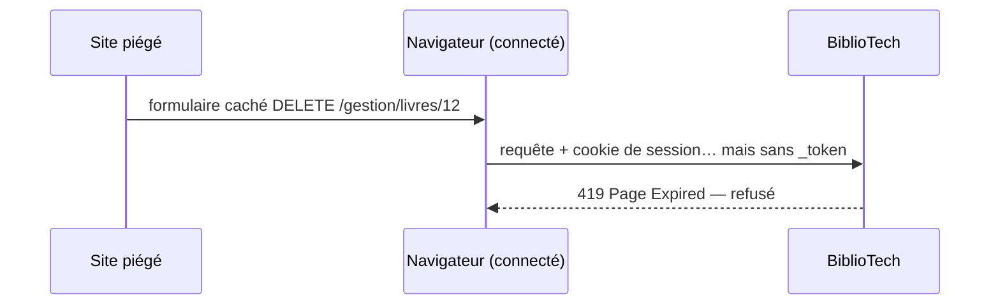

# Formulaires, verbes HTTP, CSRF

> **Séance 4** · Lecture 7 min · ▶️ [Faire la séance](../seances/seance-04.md)

## L'idée

HTTP a des **verbes** qui disent l'intention : GET *lit* (sans rien modifier), POST *crée*,
PUT *remplace*, DELETE *supprime*. Un formulaire HTML ne connaît que GET et POST : Laravel lit un
champ caché `_method` pour simuler les autres.

**CSRF** (*Cross-Site Request Forgery*) : un site piégé fait envoyer, par **votre** navigateur
connecté, un formulaire vers BiblioTech (« supprimer le livre 12 »). Parade : chaque formulaire
contient un **jeton** secret propre à votre session ; une requête sans jeton valide est refusée (**419**).



## Le code à reconnaître

```blade
<form action="{{ route('gestion.livres.update', $livre) }}" method="POST">
    @csrf                       {{-- <input type="hidden" name="_token" value="…"> --}}
    @method('PUT')              {{-- <input type="hidden" name="_method" value="PUT"> --}}
    <input name="titre" value="{{ old('titre', $livre->titre) }}">
</form>

<form action="{{ route('gestion.livres.destroy', $livre) }}" method="POST"
      onsubmit="return confirm('Supprimer ?')">
    @csrf @method('DELETE') <button>Supprimer</button>
</form>
```
```php
'isbn' => ['nullable', Rule::unique('livres', 'isbn')->ignore($this->route('livre'))],
```

## Les pièges

- **Supprimer par un lien GET** : un robot d'indexation, un aperçu de lien ou un `` piégé suffit à déclencher la suppression.
- **`unique` sans `ignore()` en modification** : l'enregistrement se heurte à… lui-même.
- **Case à cocher décochée** : elle n'est **pas envoyée**. `$request->boolean('disponible')` donne `false`.
- **Laisser la base répondre à la place du code** : une erreur de clé étrangère n'est pas un message pour l'utilisatrice ; on vérifie la règle avant.

## ✅ Auto-évaluation

1. Quel verbe HTTP pour : afficher le formulaire de modification ? enregistrer la modification ?
2. Que contient `@method('DELETE')` une fois la page générée ?
3. Expliquez une attaque CSRF en deux phrases et sa parade.
4. Pourquoi `old('titre', $livre->titre)` a-t-il deux arguments ?
5. Une catégorie contient des livres. Où vérifier qu'on ne peut pas la supprimer, et pourquoi pas seulement en base ?

<details><summary>Réponses</summary>

1. GET pour `edit`, PUT (ou PATCH) pour `update`.
2. `<input type="hidden" name="_method" value="DELETE">`.
3. Un site tiers fait envoyer par le navigateur de la victime, connectée, une requête qui agit sur BiblioTech. Le jeton CSRF, inconnu du site tiers, rend la requête invalide.
4. La saisie précédente si la validation a échoué ; sinon la valeur actuelle du livre.
5. Dans le contrôleur (ou un service), avant de supprimer : pour afficher un message clair au lieu d'une erreur SQL. La clé étrangère reste un filet de sécurité.
</details>
