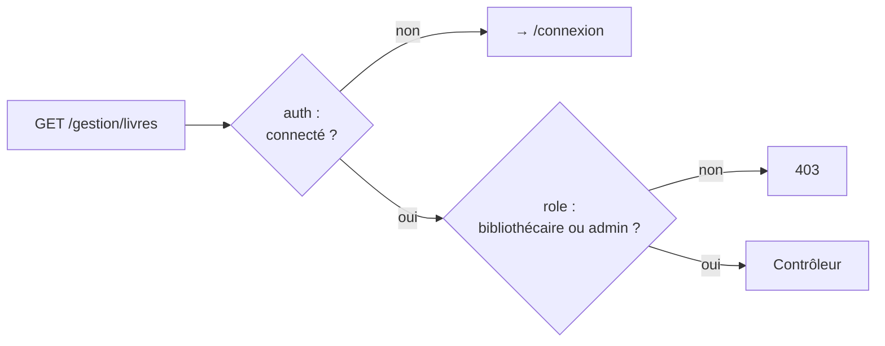

# Authentification et autorisation

> **Séance 5** · Lecture 10 min · ▶️ [Faire la séance](../seances/seance-05.md)

## L'idée

| | Question | En cas d'échec | Outil Laravel |
|---|---|---|---|
| **Authentification** | *Qui êtes-vous ?* | redirection vers `/connexion` (ou 401 en API) | `Auth::attempt()`, middleware `auth` |
| **Autorisation** | *Avez-vous le droit ?* | **403** | middleware de rôle, *Gates*, *Policies* |

Après connexion, le serveur garde l'identité dans une **session** ; le navigateur ne garde qu'un
**cookie** contenant l'identifiant de session.

Les mots de passe ne sont **jamais** stockés : on stocke une **empreinte** (bcrypt) calculée avec un
sel aléatoire. Pour vérifier, on recalcule et on compare. Une fuite de la table ne livre pas les mots de passe.



## Le code à reconnaître

```php
if (Auth::attempt(['email' => $email, 'password' => $mdp])) {
    $request->session()->regenerate();      // contre la fixation de session
    return redirect()->intended('/');       // vers la page demandée avant la connexion
}
```
```php
Route::middleware(['auth', 'role:bibliothecaire,admin'])->group(…);
Route::post('/connexion', …)->middleware('throttle:5,1');   // 5 essais par minute
```
```php
#[Fillable(['name', 'email', 'password'])]     // role n'y est PAS
class User extends Authenticatable { … 'password' => 'hashed' … }
```

## Les pièges

- **Messages d'erreur différents** (« compte inconnu » / « mot de passe faux ») : un attaquant
  apprend quels e-mails ont un compte (**énumération**). La règle `exists:users` à la connexion fait cette erreur.
- **Pas de limite de tentatives** : un robot essaie des milliers de mots de passe (**force brute**).
- **`role` remplissable** : un champ caché `role=admin` ajouté au formulaire d'inscription suffit (**affectation de masse**).
- **Masquer un bouton** n'est pas une protection : la **route** doit être protégée.

## ✅ Auto-évaluation

1. Quelle différence entre une réponse 401 et une réponse 403 ?
2. Pourquoi régénérer la session après la connexion ?
3. Que stocke-t-on dans la colonne `password` ?
4. Pourquoi l'ordre `['auth', 'role:…']` compte-t-il ?
5. Expliquez pourquoi `'email' => 'exists:users'` est une faiblesse sur un formulaire de connexion.

<details><summary>Réponses</summary>

1. 401 : on ne sait pas qui vous êtes (non authentifié). 403 : on sait qui vous êtes, et vous n'avez pas le droit.
2. Pour qu'un identifiant de session connu d'un attaquant avant la connexion (fixation) ne serve plus après.
3. L'empreinte bcrypt du mot de passe (avec son sel), jamais le mot de passe.
4. Le middleware de rôle lit `$request->user()` : il faut d'abord être sûr qu'un utilisateur est connecté.
5. Elle produit un message différent pour un e-mail inconnu : l'attaquant peut tester quels e-mails ont un compte.
</details>
