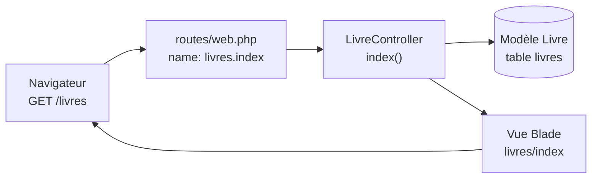

# 1️⃣ Séance 1 — Routes, contrôleurs, vues

> **Durée** 2 h · **Tests** `php artisan test --group=seance-01` · **Fiche de cours** [MVC et routage](../cours/01-mvc-routage.md)

## 🎯 Objectifs

- Suivre le trajet d'une requête : **URL → route → contrôleur → modèle → vue**
- Ajouter une page statique et des pages alimentées par la base
- Nommer ses routes et les utiliser dans les vues

## 🎬 La situation

> **De :** Mme Lefèvre, responsable de la médiathèque
> **Objet :** deux petites choses sur le site
>
> Bonjour,
> Les usagers nous demandent sans arrêt nos horaires : pouvez-vous ajouter une page **Contact** ?
> Et nous aimerions qu'on puisse **parcourir le catalogue par catégorie** (Romans, Policiers…),
> avec le nombre de livres dans chacune.
> Merci !

---

## 1 ▶️ Lancer

Ouvrez l'application (onglet **PORTS** → 8000). Parcourez : accueil, catalogue, fiche d'un livre,
recherche « hugo ». Ouvrez aussi phpMyAdmin (port 8080) → base `bibliotech` → tables `livres` et `categories`.

```bash
php artisan route:list --except-vendor   # toutes les routes de l'application
```

## 2 🔍 Comprendre — Mission 1.1 🟢 *Suivre une requête*

Répondez **par écrit** dans votre journal (ces questions reviennent au contrôle d'entrée de la séance 2) :

1. Dans `routes/web.php`, quelle ligne traite l'URL `/livres` ? Quel **contrôleur** et quelle **méthode** ?
2. Dans `app/Http/Controllers/LivreController.php`, méthode `index()` : quelle ligne interroge la base ?
   Que veut dire `with('categorie')` ?
3. Quelle **vue** est renvoyée ? Ouvrez-la : où est la boucle qui affiche les livres ?
4. Cette vue commence par `@extends('layouts.app')`. Qu'apporte `layouts/app.blade.php` à toutes les pages ?
5. L'URL `/livre/999` renvoie une page 404. Quelle instruction du contrôleur produit ce 404 ?
6. Pourquoi les vues écrivent-elles `route('livres.index')` plutôt que `'/livres'` ?



## 3 ✏️ Modifier

### Mission 1.2 🟢 — Page Contact

**Attendu :** l'URL `/contact`, nommée `contact`, affiche les horaires de la médiathèque ;
le menu contient un lien vers elle.

1. Une page sans données n'a pas besoin de contrôleur. Dans `routes/web.php` :
   ```php
   Route::view('/contact', 'contact')->name('contact');
   ```
2. Créez `resources/views/contact.blade.php` :
   ```blade
   @extends('layouts.app', ['title' => 'Contact'])

   @section('content')
   <div class="container">
       <h1>Nous contacter</h1>
       <h2 class="h4">Horaires</h2>
       <ul>
           <li>Mardi et jeudi : 14 h – 18 h</li>
           <li>Mercredi et samedi : 10 h – 12 h 30 et 14 h – 18 h</li>
       </ul>
   </div>
   @endsection
   ```
3. Dans `resources/views/layouts/app.blade.php`, ajoutez un `<li class="nav-item">` sur le modèle
   des autres, avec `href="{{ route('contact') }}"`.

✅ `php artisan test --group=seance-01 --filter=m2`

### Mission 1.3 🟡 — Liste des catégories

**Attendu :** `/categories` (route `categories.index`) liste les catégories **actives** par ordre
alphabétique ; chacune affiche son nombre de livres sous la forme `3 livre(s)` et renvoie vers sa page.

**Étapes**
1. `php artisan make:controller CategorieController`
2. Une méthode `index()` qui récupère les catégories actives **avec le nombre de leurs livres**.
3. Une route `GET /categories` nommée `categories.index`.
4. Une vue `resources/views/categories/index.blade.php`.

> 💡 **Indice.** Le modèle `Categorie` a déjà un *scope* `actives()` et une relation `livres()`.
> Eloquent sait compter une relation sans charger les livres : cherchez `withCount` dans la
> [documentation](https://laravel.com/docs/eloquent-relationships#counting-related-models). Le résultat
> est disponible dans l'attribut `livres_count`.

✅ `php artisan test --group=seance-01 --filter=m3`

### Mission 1.4 🟡 — Les livres d'une catégorie

**Attendu :** `/categories/{slug}` (route `categories.show`) affiche le nom de la catégorie et
**ses** livres, avec le composant `<x-livre-card>`. Un slug inconnu renvoie **404**.

> 💡 **Indice.** Le *slug* est le morceau d'URL lisible (`science-fiction`). Récupérez la catégorie
> avec `where('slug', $slug)->firstOrFail()` : *OrFail* produit le 404 tout seul.
> Les livres : `$categorie->livres`.

✅ `php artisan test --group=seance-01 --filter=m4`

### Mission 1.5 🔴 — Une page 404 à l'image du site

**Attendu :** une URL inconnue affiche « Page introuvable » dans le gabarit du site, avec un lien
vers le catalogue. *(test : `--group=bonus --filter=s1_m5`)*

## 4 ✅ Valider

```bash
php artisan test --group=seance-01   # tout vert
php artisan test --group=socle       # toujours vert
git add -A
git commit -m "feat: page contact et navigation par catégorie"
git push
```

Cochez la séance 1 dans `PROGRESSION.md`.

---

## 📌 Concepts à connaître

*Ce sont les cinq points du contrôle d'entrée de la séance 2.*

1. **MVC** — le contrôleur reçoit la requête, interroge le modèle, transmet les données à la vue ; la vue n'interroge pas la base.
2. **Route nommée** — `->name('contact')` puis `route('contact')` : l'URL peut changer sans casser les liens.
3. **Paramètre de route** — `/categories/{slug}` : le segment d'URL arrive en argument de la méthode.
4. **`findOrFail` / `firstOrFail`** — « trouve ou renvoie 404 » : pas de page blanche ni d'erreur 500.
5. **Héritage Blade** — `@extends` + `@section` : une seule mise en page pour tout le site.

## 📓 Journal de fin de séance (portail)

Ce que j'ai fait · ce qui m'a bloqué · ce que j'ai compris aujourd'hui.
