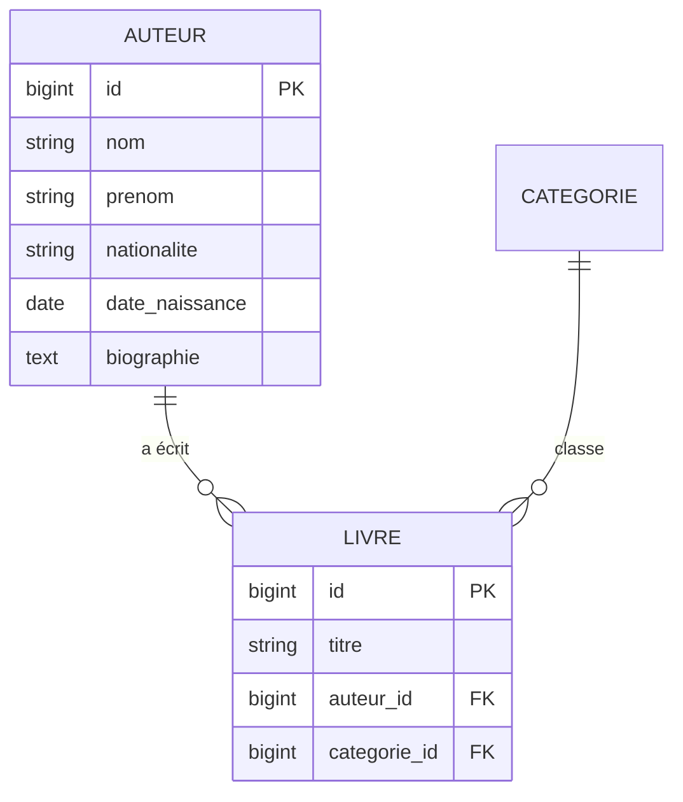

# 2️⃣ Séance 2 — Base de données & Eloquent : la table `auteurs`

> **Durée** 2 h · **Tests** `php artisan test --group=seance-02` · **Fiche de cours** [Migrations et relations](../cours/02-eloquent-migrations.md)

## 🎯 Objectifs

- Créer une table par **migration** et son **modèle** Eloquent
- Transformer une colonne texte en **clé étrangère** sur une base qui contient déjà des données
- Déclarer et utiliser une relation **1 → N** dans les deux sens

## 🎬 La situation

> **De :** Mme Lefèvre
> **Objet :** nos auteurs
>
> En préparant la vitrine « Victor Hugo », on s'est aperçu qu'on ne peut pas lister ses livres
> proprement : l'auteur est tapé à la main sur chaque fiche. On aimerait aussi, un jour, afficher
> une petite biographie. Est-ce possible sans tout ressaisir ?

Aujourd'hui, `livres.auteur` est un simple texte : « Victor Hugo » est écrit deux fois, rien
n'empêche d'écrire « V. Hugo » la troisième. La réponse de l'informaticien : **une table `auteurs`**,
et dans `livres` une **clé étrangère** `auteur_id`.



> 🔗 Vous reconnaissez le MCD du module de modélisation : une association 1,1 — 0,n devient une
> **clé étrangère** du côté « 1,1 ».

---

## 1 ▶️ Lancer

```bash
php artisan migrate:status          # les migrations déjà passées
php artisan tinker
>>> App\Models\Livre::where('auteur', 'like', '%Hugo%')->pluck('titre')
>>> exit
```

## 2 🔍 Comprendre

Ouvrez `database/migrations/2025_09_26_113450_add_categorie_id_to_livres_table.php`.

1. Cette migration **modifie** une table existante : quelle méthode de `Schema` l'indique ?
2. Que fait `->constrained('categories')` ? Et `->nullOnDelete()` ?
3. Le commentaire parle de `->after()` : l'an dernier, cette ligne visait une colonne qui n'existait pas.
   Pourquoi SQLite l'acceptait-il et pas MySQL ? (Indice : [DEPANNAGE.md](../DEPANNAGE.md).)
4. Dans `app/Models/Livre.php`, comment s'appelle la méthode qui relie un livre à sa catégorie ?
   Quel type de relation renvoie-t-elle ?

## 3 ✏️ Modifier

### Mission 2.1 🟢 — Table et modèle `Auteur`

```bash
php artisan make:model Auteur -mf      # modèle + migration (m) + fabrique (f)
```

**La migration** (`database/migrations/…_create_auteurs_table.php`), dans `up()` :
```php
Schema::create('auteurs', function (Blueprint $table) {
    $table->id();
    $table->string('nom');
    $table->string('prenom')->nullable();
    $table->string('nationalite', 100)->nullable();
    $table->date('date_naissance')->nullable();
    $table->text('biographie')->nullable();
    $table->timestamps();
});
```

**Le modèle** `app/Models/Auteur.php` :
```php
protected $fillable = ['nom', 'prenom', 'nationalite', 'date_naissance', 'biographie'];

protected function casts(): array
{
    return ['date_naissance' => 'date'];
}

/** $auteur->nom_complet : un attribut calculé, pas une colonne */
protected function nomComplet(): Attribute
{
    return Attribute::get(fn () => trim($this->prenom.' '.$this->nom));
}
```
(`use Illuminate\Database\Eloquent\Casts\Attribute;` en haut du fichier.)

**La fabrique** `database/factories/AuteurFactory.php`, méthode `definition()` :
```php
return [
    'nom' => $this->faker->lastName(),
    'prenom' => $this->faker->firstName(),
    'nationalite' => 'française',
];
```

```bash
php artisan migrate
php artisan test --group=seance-02 --filter=m1
```

### Mission 2.2 🟢 — Remplacer le texte `auteur` par la clé `auteur_id`

La base contient déjà 20 livres. On ne vide pas une base en service : on la fait **évoluer**,
en trois temps, dans **une seule migration**.

```bash
php artisan make:migration remplacer_auteur_texte_par_auteur_id --table=livres
```

```php
public function up(): void
{
    // 1. La nouvelle colonne, vide pour l'instant
    Schema::table('livres', function (Blueprint $table) {
        $table->foreignId('auteur_id')->nullable()->after('titre')
            ->constrained('auteurs')->nullOnDelete();
    });

    // 2. Le transfert : un auteur par nom distinct. On utilise DB et non les modèles :
    //    une migration doit encore fonctionner quand les modèles auront changé.
    $noms = DB::table('livres')->whereNotNull('auteur')->distinct()->pluck('auteur');

    foreach ($noms as $nomComplet) {
        $morceaux = preg_split('/\s+/', trim($nomComplet));
        $nom = array_pop($morceaux);               // dernier mot = nom
        $prenom = implode(' ', $morceaux) ?: null; // le reste = prénom

        $auteurId = DB::table('auteurs')->insertGetId([
            'nom' => $nom, 'prenom' => $prenom, 'created_at' => now(), 'updated_at' => now(),
        ]);

        DB::table('livres')->where('auteur', $nomComplet)->update(['auteur_id' => $auteurId]);
    }

    // 3. L'ancienne colonne. Elle fait partie d'un index : on retire l'index d'abord.
    Schema::table('livres', function (Blueprint $table) {
        $table->dropIndex(['titre', 'auteur']);
        $table->index('titre');
        $table->dropColumn('auteur');
    });
}
```
(`use Illuminate\Support\Facades\DB;` en haut.) Écrivez aussi `down()` : l'opération inverse.

```bash
php artisan migrate
```
Vérifiez dans phpMyAdmin : la table `auteurs` est remplie, `livres.auteur` a disparu, chaque livre a un `auteur_id`.

**Puis faites suivre le code** — c'est là que les tests vous aident :

1. `Livre` : remplacez `'auteur'` par `'auteur_id'` dans `$fillable` et ajoutez la relation
   ```php
   public function auteur(): BelongsTo
   {
       return $this->belongsTo(Auteur::class);
   }
   ```
2. `Auteur` : la relation inverse `livres()` (un auteur → plusieurs livres : `hasMany`).
3. `LivreFactory` : `'auteur' => $this->faker->name()` devient `'auteur_id' => Auteur::factory()`.
   *Tant que ce n'est pas fait, le **socle** est rouge : la fabrique remplit une colonne qui n'existe plus.*
4. Les vues : `{{ $livre->auteur }}` devient `{{ $livre->auteur?->nom_complet }}`
   (carte `components/livre-card.blade.php` et fiche `livres/show.blade.php`).
5. Les contrôleurs : `with('categorie')` devient `with(['categorie', 'auteur'])` — sinon une requête SQL par livre affiché.

```bash
php artisan test --group=seance-02 --filter=m2
php artisan test --group=socle
```

### Mission 2.3 🟡 — Seeders et recherche par auteur

**Attendu :**
- `php artisan migrate:fresh --seed` produit des livres **reliés à leurs auteurs**, sans doublon
  (Victor Hugo : un seul auteur, deux livres).
- `/recherche?q=Zola` trouve *Germinal* : la recherche porte sur le titre **ou** le nom/prénom de l'auteur.

> 💡 **Indices.** Dans `LivreSeeder`, `Auteur::firstOrCreate([...])` crée l'auteur seulement s'il
> n'existe pas. Pour la recherche, le scope `recherche()` du modèle `Livre` ne peut plus lire une
> colonne `auteur` : il doit chercher **dans la table liée** — voyez `orWhereHas`.
> Gardez le `where(function …)` qui entoure les conditions : sans parenthèses, un `OR` « avale » les
> autres filtres d'une requête.

✅ `php artisan test --group=seance-02`

### Mission 2.4 🔴 — La page d'un auteur

**Attendu :** `/auteurs/{auteur}` (route `auteurs.show`) affiche le nom complet de l'auteur et ses
livres ; sur la fiche d'un livre, le nom de l'auteur devient un lien vers cette page.
*(test : `--group=bonus --filter=s2_m4`)*

## 4 ✅ Valider

```bash
php artisan test --group=seance-02 && php artisan test --group=socle
git add -A && git commit -m "feat: table auteurs et reprise des données" && git push
```

---

## 📌 Concepts à connaître

1. **Migration** — un fichier versionné qui fait évoluer le schéma ; `up()` pour avancer, `down()` pour revenir.
2. **Clé étrangère** — `auteur_id` référence `auteurs.id` ; la base refuse un auteur inexistant.
3. **`belongsTo` / `hasMany`** — les deux côtés d'une relation 1 → N ; la clé étrangère est du côté `belongsTo`.
4. **Chargement anticipé** — `with('auteur')` : 2 requêtes au lieu de N + 1.
5. **Reprise de données** — ajouter, transférer, supprimer : on fait évoluer une base en service sans la vider.

## 📓 Journal de fin de séance (portail)

Question de réflexion : la règle « dernier mot = nom » donne *prénom « Antoine de », nom « Saint-Exupéry »*.
Que feriez-vous dans une vraie reprise de données ?
