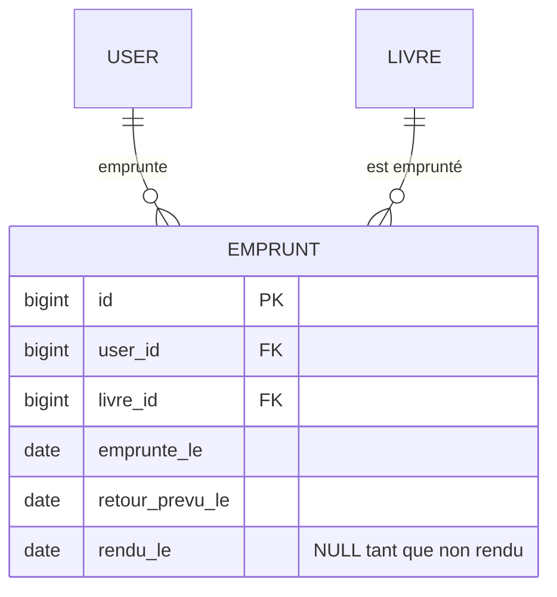

# 6️⃣ Séance 6 — Les emprunts : règles de gestion et transactions

> **Durée** 2 h · **Tests** `php artisan test --group=seance-06` · **Fiche de cours** [Règles de gestion et transactions](../cours/06-regles-transactions.md)

## 🎯 Objectifs

- Passer d'une association porteuse de données (MCD) à une **table** avec deux clés étrangères
- Écrire des **règles de gestion** à un seul endroit, hors du contrôleur
- Garantir la cohérence avec une **transaction**

## 🎬 La situation

> **De :** Mme Lefèvre
> **Objet :** emprunts en ligne
>
> Le conseil communautaire a voté : les adhérents pourront **réserver en ligne** un livre disponible,
> à retirer au comptoir. Nos règles, qui existent déjà sur papier :
> - un livre emprunté n'est plus disponible ;
> - **3 emprunts en cours maximum** par adhérent ;
> - durée du prêt : **21 jours** ;
> - c'est la bibliothécaire qui enregistre le **retour**.



> 🔗 Au MCD, EMPRUNTER est une association entre ADHÉRENT et LIVRE qui **porte des données** (les dates)
> et peut se répéter pour le même couple : elle devient une table à part entière.

---

## 1 ▶️ Lancer

Connectez-vous avec `adherent@bibliotech.test` : la fiche d'un livre propose-t-elle d'emprunter ?
Pas encore.

## 2 🔍 Comprendre

1. Pourquoi une colonne `rendu_le` vide plutôt qu'une suppression de la ligne au retour ?
2. Deux adhérents cliquent sur « Emprunter » le même livre à la même seconde. Que peut-il se passer ?
3. Où écrire la règle « 3 emprunts maximum » pour qu'elle s'applique aussi à l'API de la séance 7 ?

## 3 ✏️ Modifier

### Mission 6.1 🟢 — Table, modèle, relations

```bash
php artisan make:model Emprunt -m
```
```php
// migration, up()
Schema::create('emprunts', function (Blueprint $table) {
    $table->id();
    $table->foreignId('user_id')->constrained()->cascadeOnDelete();
    $table->foreignId('livre_id')->constrained('livres')->cascadeOnDelete();
    $table->date('emprunte_le');
    $table->date('retour_prevu_le');
    $table->date('rendu_le')->nullable();
    $table->timestamps();
});
```
Dans `Emprunt` : `$fillable`, les *casts* `date` sur les trois dates, les relations `user()` et
`livre()` (`belongsTo`), et un *scope* :
```php
public function scopeEnCours(Builder $query): Builder
{
    return $query->whereNull('rendu_le');
}
```
Puis la relation **inverse** `emprunts()` (`hasMany`) dans `User` **et** dans `Livre`.

✅ `php artisan migrate && php artisan test --group=seance-06 --filter=m1`

### Mission 6.2 🟢 — Emprunter un livre

On isole les règles dans une classe de **service** : le contrôleur gère le HTTP, le service décide.

`app/Services/ServiceEmprunt.php` :
```php
class ServiceEmprunt
{
    public const DUREE_JOURS = 21;

    public function emprunter(User $adherent, Livre $livre): Emprunt
    {
        return DB::transaction(function () use ($adherent, $livre) {
            $emprunt = $adherent->emprunts()->create([
                'livre_id' => $livre->id,
                'emprunte_le' => today(),
                'retour_prevu_le' => today()->addDays(self::DUREE_JOURS),
            ]);

            $livre->update(['disponible' => false]);

            return $emprunt;
        });
    }
}
```
`DB::transaction` : si une instruction échoue, **aucune** n'est enregistrée.

Un contrôleur `EmpruntController`, méthode `store(Request $request, Livre $livre)` qui appelle le
service (injecté dans le constructeur) et redirige `back()` avec un message `success`.
La route, réservée aux utilisateurs connectés :
```php
Route::post('/livres/{livre}/emprunter', [EmpruntController::class, 'store'])
    ->middleware('auth')->name('livres.emprunter');
```
Sur la fiche d'un livre disponible : un bouton « Emprunter » (formulaire POST, `@csrf`) pour un
utilisateur connecté, « Connectez-vous pour emprunter » sinon.

✅ `php artisan test --group=seance-06 --filter=m2`

### Mission 6.3 🟡 — Les règles de gestion

**Attendu :**
- emprunter un livre **indisponible** est refusé : message `error`, aucun emprunt créé ;
- un 4ᵉ emprunt en cours est refusé : message `error`, et le livre reste disponible.

> 💡 **Indices.**
> - Créez une exception `App\Exceptions\EmpruntImpossible` (elle étend `RuntimeException`) ;
>   le service la **lève** avec un message pour l'adhérent, le contrôleur l'**attrape** et en fait un message `error`.
> - Les vérifications se font **dans** la transaction, avant de créer l'emprunt.
> - Pour la question 2 (deux clics simultanés), cherchez `lockForUpdate()`.

✅ `php artisan test --group=seance-06 --filter=m3`

### Mission 6.4 🟡 — Mes emprunts, retour d'un livre

**Attendu :**
- `/mes-emprunts` (route `emprunts.mes`, connecté) liste **mes** emprunts en cours avec la date de retour ;
  un emprunt en retard est signalé ;
- `POST /gestion/emprunts/{emprunt}/retour` (route `gestion.emprunts.retour`, **personnel seulement**)
  renseigne `rendu_le` et rend le livre disponible — dans une transaction, via le service.

✅ `php artisan test --group=seance-06`

### Mission 6.5 🔴 — Les retards

**Attendu :** `/gestion/emprunts/retards` (route `gestion.emprunts.retards`) liste les emprunts en
cours dont la date de retour est dépassée, avec un bouton « Enregistrer le retour ».
*(test : `--group=bonus --filter=s6_m5` ; un *scope* `enRetard()` sera bienvenu.)*

## 4 ✅ Valider

```bash
php artisan test --group=seance-06 && php artisan test --group=socle
git add -A && git commit -m "feat: emprunts et retours" && git push
```

---

## 📌 Concepts à connaître

1. **Association porteuse** — une association du MCD qui a ses propres données devient une table à deux clés étrangères.
2. **Service** — une classe qui porte les règles de gestion ; le contrôleur ne fait que traduire HTTP.
3. **Transaction** — tout ou rien : l'emprunt et l'indisponibilité du livre sont enregistrés ensemble.
4. **Exception métier** — la règle refuse en levant une exception ; le contrôleur la transforme en message.
5. **Scope** — `enCours()`, `enRetard()` : une condition métier nommée, réutilisable partout.

## 📓 Journal de fin de séance (portail)

Ce que j'ai fait · ce qui m'a bloqué · ce que j'ai compris aujourd'hui.
